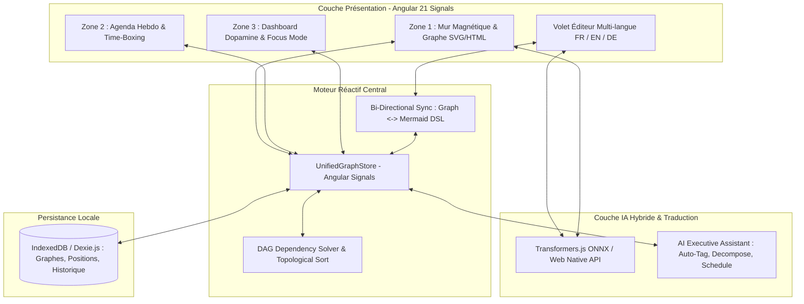

Pour transformer **Taskstick** (actuellement en v1.2.0 centrée sur Mermaid et l'éditeur Monaco) en un véritable exosquelette cognitif adapté au TDAH, l'application doit éliminer toute friction entre l'apparition d'une pensée et sa capture spatiale, tout en automatisant le passage du « chaos créatif » à l'exécution séquentielle.

Voici la proposition complète alliant neuro-ergonomie, architecture réactive et intelligence artificielle hybride.

---

## 1. Concept : « Dopamine-Driven Spatial Flow »

Un cerveau TDAH fonctionne par association spatiale, souffre souvent de cécité temporelle (*time blindness*) et décroche face à la paralysie de l'analyse (trop d'étapes pour noter ou planifier une tâche). Le concept étend la vision v2.0.0 (`poc_taskstick2.md`) autour de 5 piliers ergonomiques :

* **Capture Zéro-Friction (« Brain Dump » Multimodal) :** Raccourci global (`Espace` ou `Ctrl+K`) et dictée vocale instantanée qui projettent des Post-it directement sur le mur blanc magnétique sans obliger l'utilisateur à choisir une catégorie ou une syntaxe Mermaid au préalable.


* **Physique Tactile & Magnétisme Dopaminergique :** Renforcer l'algorithme `evaluateSticking` prévu dans le SDD avec un retour visuel (animations *spring physics*, halo magnétique quand deux notes s'approchent à moins de `30px`) et micro-sonore (bruit feutré de papier ou d'aimant au collage et au marquage ❌ / ✓).


* **Arbres de Pensée par Liens Sémantiques Typés :** Au-delà du simple collage en cluster (`NoteCluster`), permettre de tirer un câble visuel (courbe de Bézier magnétique) entre deux Post-it ou deux clusters avec 3 types de relations :


* 🔴 **Bloquant / Dépendance (`blocks`) :** La tâche B est grisée tant que A est au statut `open` (⭕).


* 🟡 **Contrainte (`requires`) :** Condition matérielle, énergétique ou externe.
* 🔵 **Synergie (`relates_to`) :** Idées cousines à traiter dans le même contexte mental.


* **Mode « Hyperfocus Spotlight » (Anti-Surcharge) :** Un bouton qui assombrit 90 % du tableau blanc et n'éclaire que le nœud racine (la prochaine action réalisable sans dépendance bloquante) et son voisinage direct.
* **Agenda « Énergie vs Temps » :** Au lieu d'un calendrier rigide, chaque Post-it reçoit un poids cognitif (⚡ *High Focus*, 🔋 *Medium*, 🪶 *Low/Admin*). L'agenda hebdomadaire place visuellement les tâches lourdes sur les pics d'énergie biologiques et regroupe les petites tâches en blocs de *batching*.

---

## 2. Architecture Cible (v2.5 « Neuro-Spatial Engine »)

L'architecture actuelle utilise une chaîne de texte brute (`diagram: string`) stockée dans `localStorage` (`journal-YYYYMMDD`) comme source de vérité unique. Pour supporter à la fois le mur magnétique, les arbres de dépendances, le multilingue (`fr`, `en`, `de`) et l'agenda, il faut inverser le flux : **le Graphe Spatial Unifié devient la source de vérité**, et le code Mermaid / Kanban / Agenda n'en sont que des projections réactives.

### Topologie Système



### Extension du Modèle de Données (Complément au SDD Section 2.1

)

En complément de `PostItNote`, `NoteCluster` et `WhiteboardZone` déjà définis dans le SDD, voici les contrats nécessaires pour les liens logiques, le multilingue par nœud et la planification :

```typescript
import { PostItNote, SupportedLanguage, MultiLanguageContent } from './models';

export type RelationType = 'depends_on' | 'constrains' | 'synergy' | 'parent_of';
export type CognitiveLoad = 'low' | 'medium' | 'high';

export interface PostItEdge {
  id: string;
  sourceId: string;       // ID du Post-it parent / prérequis
  targetId: string;       // ID du Post-it enfant / dépendant
  type: RelationType;
  label?: Partial<MultiLanguageContent>;
}

export interface ADHDPostItNote extends PostItNote {
  // Support multilingue natif sur chaque Post-it (FR, EN, DE)
  translations: Partial<MultiLanguageContent>;
  
  // Attributs TDAH & Planification
  cognitiveLoad: CognitiveLoad;
  estimatedMinutes: number;       // Ex: 15, 30, 60 (Time-boxing)
  isBlocked: boolean;             // Calculé dynamiquement par le DAG Solver
  
  // Liaison Agenda de la semaine
  scheduledSlot?: {
    dayOfWeek: 1 | 2 | 3 | 4 | 5 | 6 | 7; // Lundi à Dimanche
    startHour: number;                     // Ex: 9.5 pour 09h30
    durationMinutes: number;
  };
}

```

---

## 3. Outils & Pile Technologique Recommandés

En s'appuyant sur la base existante (**Angular 21**, **TypeScript 5.9**, **Monaco**, **Mermaid**, **Panzoom**, **Transformers.js**), voici les briques à ajouter :

| Besoin Fonctionnel | Outil / Librairie Recommandé | Justification Technique & Ergonomique |
| --- | --- | --- |
| **Graphe Spatial & Liens** | **Couche hybride HTML + SVG** sur le `panzoom` existant (ou `@foblex/flow` / `ngx-vflow`)

 | Les Post-it restent des éléments DOM HTML fluides (faciles à éditer et styliser avec les palettes pastel de `mindmap-styling.ts`), tandis qu'un calque `<svg>` en arrière-plan trace les courbes de Bézier des liens de dépendance.

 |
| **État Réactif** | **Angular Signals** (`signal`, `computed`, `effect`) | Natif dans Angular 21. Permet de recalculer instantanément les arbres de dépendances (`isBlocked`), les filtres de tags et les KPIs du Dashboard sans latence.

 |
| **Persistance Locale** | **Dexie.js** (Wrapper IndexedDB) | Remplace avantageusement le `localStorage` synchrone actuel qui bloquera le thread principal dès que le mur contiendra des centaines de notes, leurs traductions (`fr`, `en`, `de`) et l'historique Undo/Redo.

 |
| **IA Locale / Hybride** | **WebLLM / Ollama API locale** + **`@xenova/transformers`** existant

 | Conserve `@xenova/transformers` (dans un **Web Worker** dédié pour éviter tout gel de l'UI au-delà du découpage actuel en micro-batchs de 5 lignes) pour la traduction FR/EN/DE, et connecte un LLM (local ou API) dans `AiAgentService` pour l'analyse de graphe et l'agenda.

 |
| **Capture Vocale** | **Web Speech API** (`webkitSpeechRecognition`) | Natif au navigateur, latence nulle pour dicter des idées à la volée en FR, EN ou DE et les transformer en Post-it. |

---

## 4. Fonctionnalités IA Ciblées contre le TDAH (Évolution de `AiAgentService`

)

Le service actuel `AiAgentService` utilise un simple parseur de préfixes (`task:`, `event:`, `email:`). Il peut devenir un véritable **copilote de fonction exécutive** grâce à 4 actions concrètes :

1. **Le « Goblin Decomposer » (Briseur de tâches intimidantes) :**
* *Problème TDAH :* Un Post-it intitulé *"Refaire l'architecture base de données"* est trop vaste et provoque de la procrastination.
* *Action IA :* Un clic sur un bouton 🪄 **« Découper »** sur le Post-it génère automatiquement 4 sous-Post-it de 20 minutes maximum, collés en cluster ou reliés par des flèches séquentielles `depends_on`.


2. **Auto-Clustering & Inférence des Dépendances :**
* *Action IA :* Après une session de *Brain Dump* où 20 Post-it sont jetés en vrac sur le mur, le bouton **« AI Organize »** analyse le texte des notes, leur attribue automatiquement une couleur thématique (`PostItColor`), génère les `#tags`, et propose des liens logiques (ex: *"Tu as noté 'Envoyer le devis' et 'Valider le chiffrage' : veux-tu relier le second comme prérequis du premier ?"*).


3. **Optimiseur d'Agenda Hebdomadaire (Topological Time-Boxer) :**
* *Action IA :* L'algorithme effectue d'abord un **tri topologique** sur les arbres de pensée (les feuilles/racines sans prérequis non faits passent en priorité), puis les place dans la grille de la semaine (Zone 2) en alternant les tâches à forte charge cognitive (⚡) le matin et les tâches légères (🪶) en début d'après-midi, avec des tampons de transition de 15 minutes.


4. **Pont Multilingue Collaboratif (FR / EN / DE) :**
* En capitalisant sur la logique de traduction pivot (`fr <-> en <-> de`) déjà présente dans `EditorComponent`, un sélecteur global de langue dans le header traduit en temps réel tous les Post-it du mur et l'agenda. Tu peux ainsi réfléchir et capturer tes idées en français, puis basculer tout le tableau blanc en allemand ou en anglais en un clic lors d'un partage d'écran avec un intervenant externe.


---

## 5. Plan d'Implémentation en 4 Phases

Ce plan s'aligne sur la transition AS-IS (v1.2.0) vers TO-BE (v2.0.0) décrite dans le TAD, en y injectant les briques TDAH et Graphe :

### Phase 1 : Socle de Données Unifié & Mur Magnétique Tactile (Semaines 1-2)

* **Store Centralisé (`TaskstickStore`) :** Créer le store basé sur les *Angular Signals* gérant `ADHDPostItNote[]`, `NoteCluster[]`, `WhiteboardZone[]` et `PostItEdge[]`, avec sauvegarde automatique dans IndexedDB et adaptateur de rétrocompatibilité pour les entrées `journal-YYYYMMDD` existantes.


* Composant `IdeationWallComponent` (Zone 1) :


* Implémenter la grille infinie (`panzoom`) avec création de Post-it au double-clic ou via barre de saisie rapide + dictée vocale.


* Coder l'algorithme d'aimantation `evaluateSticking` (rayon `snapRadius = 30px`), le déplacement solidaire `NoteCluster`, et le bouton de cycle de statut ⭕ (`open`) $\rightarrow$ ❌ (`done_cross`) $\rightarrow$ ✓ (`done_check`).


### Phase 2 : Arbres de Pensée, Liens Logiques & Synchronisation Mermaid (Semaines 3-4)

* **Calque SVG de Connexions :** Permettre de tirer des flèches entre les Post-it pour créer des `PostItEdge` (`depends_on`, `constrains`, `synergy`).
* **Moteur de Résolution DAG :** Calculer en temps réel la propriété `isBlocked` sur chaque note (une note dont un parent `depends_on` est encore ⭕ `open` affiche un cadenas visuel).
* **Synchroniseur Bidirectionnel :** Générer automatiquement le code Mermaid (`mindmap`, `kanban`, `ishikawa-beta`) à partir du graphe de Post-it pour conserver la compatibilité avec `VisualizerComponent` et `EditorComponent`.


### Phase 3 : Agenda Hebdomadaire Adaptatif & Mode Focus (Semaines 5-6)

* **Refonte de la Zone 2 (`WeeklyPlannerComponent`) :**
* Diviser la Zone 2 en deux volets : à gauche la liste des tâches filtrées et triées par priorité logique (les tâches débloquées en tête), à droite la grille des 7 jours de la semaine.
* Glisser-déposer d'un Post-it du mur ou de la liste directement dans un créneau horaire de la semaine.


* Dashboard Dopamine (Zone 3) & Spotlight Mode :


* Ajouter le mode *Hyperfocus* qui masque tout sauf la tâche en cours avec un minuteur visuel (Time-Timer circulaire).


### Phase 4 : Copilote IA & Multilingue Temps Réel sur le Graphe (Semaines 7-8)

* **Web Worker de Traduction :** Déporter l'exécution ONNX de `@xenova/transformers` actuellement dans `EditorComponent` vers un Web Worker dédié (`TranslationWorkerService`) pour traduire à la volée à la fois l'éditeur Monaco et les titres/contenus des Post-it sur le mur en `FR`, `EN` et `DE`.


* Branchement LLM dans `AiAgentService` : Implémenter les fonctions `decomposeTask(noteId)`, `inferDependencies(notes[])` et `autoScheduleWeek(notes[], availability)` pour assister l'organisation hebdomadaire en un clic.


---

Souhaites-tu que nous commencions par coder le prototype du **`TaskstickStore` (modèle unifié avec graphe de dépendances)** ou directement le composant visuel du **Mur Magnétique (`IdeationWallComponent`)** avec les courbes de liaison SVG ?