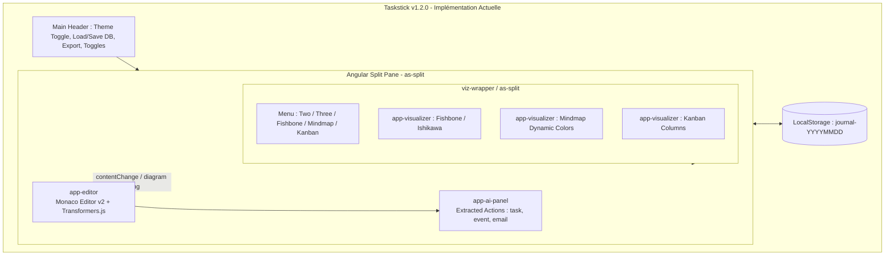

# Technical Architecture Document (TAD) — Taskstick

**System:** Taskstick  
**Author:** AI Technical Specialist & Software Architect  
**Location:** [TAD_taskstick.md](file:///c:/Dev/Taskstick/docs/TAD_taskstick.md)  
**Date:** 2026-10-26  

---

> [!IMPORTANT]
> **Strict Distinction Framework:**  
> This document is strictly partitioned into two distinct architectural horizons to avoid any ambiguity:
> - **SECTION 1 — ÉTAT ACTUEL (AS-IS - v1.2.0):** What is **currently implemented and running** in the codebase.
> - **SECTION 2 — ARCHITECTURE CIBLE (TO-BE - v2.0.0):** What **will exist** following the requirements outlined in [poc_taskstick2.md](file:///c:/Dev/Taskstick/docs/poc_taskstick2.md) (Mur à Idées, Gestionnaire de Tâches, Dashboard).
> - **SECTION 3 — PLAN DE TRANSITION (MIGRATION GAP ANALYSIS):** Concrete technical path to evolve from AS-IS to TO-BE.

---

# SECTION 1 — ÉTAT ACTUEL (AS-IS - v1.2.0)

## 1.1. Vue d'Ensemble & Fonctionnalités Réelles Existantes
Taskstick v1.2.0 est une application web monopage (SPA) cliente construite avec **Angular 21**. Elle fonctionne comme un atelier visuel synchronisé entre du code déclaratif (DSL / Mermaid) et des visualisations graphiques pan/zoom.

### Fonctionnalités Existantes dans le Code :
1. **Éditeur Monaco Multi-Langue ([editor.component.ts](file:///c:/Dev/Taskstick/src/app/editor/editor.component.ts)) :**
   - Édition de diagrammes Mermaid / texte.
   - 3 onglets de langues (`FR`, `EN`, `DE`).
   - Moteur de traduction IA client : Web Translation API native (`window.translation`) ou exécution locale ONNX via `@xenova/transformers` (`nllb-200-distilled-600M`).
2. **Visualiseur Multi-Vues Mermaid ([visualizer.component.ts](file:///c:/Dev/Taskstick/src/app/visualizer/visualizer.component.ts)) :**
   - Support des vues : `Fishbone` (diagramme Ishikawa), `Mindmap` (carte mentale avec colorations dynamiques CSS custom) et `Kanban`.
   - Navigation infinie, drag & wheel-zoom via la librairie `panzoom`.
   - Agencements d'écrans configurables via `angular-split` (`as-split`) : Mode *Two* (Split), Mode *Three* (Grid), et modes pleine page individuels.
3. **Panneau d'Extraction d'Actions IA ([ai-panel.component.ts](file:///c:/Dev/Taskstick/src/app/ai-panel/ai-panel.component.ts) & [ai-agent.service.ts](file:///c:/Dev/Taskstick/src/app/services/ai-agent.service.ts)) :**
   - Parseur de directives textuelles préfixées : `task:`, `event:`, `email:`.
   - Déclencheurs simulés pour création de cartes Trello, événements Google Calendar et brouillons email (`mailto:`).
4. **Persistance & Navigation Temporelle ([storage.service.ts](file:///c:/Dev/Taskstick/src/app/services/storage.service.ts) & [date-selector.component.ts](file:///c:/Dev/Taskstick/src/app/date-selector/date-selector.component.ts)) :**
   - Persistance dans le `localStorage` du navigateur indexée par date : clés `journal-YYYYMMDD`.
   - Export et import de fichiers `.mmd` / `.txt` et export d'images PNG/SVG.
   - Thème dynamique Sombre / Clair avec animations CSS View Transitions.

---

## 1.2. Topologie Actuelle des Composants (AS-IS)



---

## 1.3. Pile Technologique Actuelle (AS-IS)

| Dépendance / Package | Version Actuelle | Utilisation Concrète en Production |
|---|---|---|
| `@angular/core`, `@angular/common` | `^21.2.0` | Architecture Standalone, DI, cycle de vie |
| `typescript` | `~5.9.2` | Typage statique strict |
| `ngx-monaco-editor-v2` | `^20.3.0` | Intégration de l'éditeur Monaco (VS Code core) |
| `mermaid` | `^11.14.0` | Génération dynamique des SVG Ishikawa, Mindmap, Kanban |
| `panzoom` | `^9.4.4` | Zoom molette et pan 2D sur les conteneurs SVG |
| `angular-split` | `^20.0.0` | Séparateurs horizontaux et verticaux redimensionnables |
| `@xenova/transformers` | `^2.17.2` | Modèle de traduction local ONNX dans le navigateur |
| `@angular/build` / `vite` | `^21.2.8` | Bundler et serveur de développement rapide |

---

# SECTION 2 — ARCHITECTURE CIBLE (TO-BE - v2.0.0)

## 2.1. Vision Produit & Spécifications Définies dans `poc_taskstick2.md`
La version cible (v2.0.0) transforme l'application en un espace complet d'idéation et de pilotage articulé autour de **3 Zones Majeures** accessibles via une barre de navigation principale :

1. **ZONE 1 : Le Mur à Idées (Ideation Wall) :**
   - Un **tableau blanc magnétique virtuel**.
   - Des **Post-it de différentes couleurs** positionnables librement.
   - **Déplacement libre** par Drag & Drop.
   - **Magnétisme & Adhérence (Collage) :** Possibilité de coller des Post-it les uns aux autres pour former des blocs solidaires (clusters).
   - **Regroupements multidimensionnels :**
     - Par *couleur* (jaune, rose, vert, bleu, violet, orange).
     - Par *zone délimitée* sur le mur (ex: Backlog, Idées en vrac, Urgent, En cours).
     - Par *tag / étiquette* (ex: `#design`, `#infra`, `#client`).
   - **Indicateurs de complétion :** Marquage visuel clair par un **rond ⭕** (ouvert / en cours) ou une **croix ❌ / coche ✓** (fait / terminé).

2. **ZONE 2 : Gestion des Tâches (Task Management) :**
   - Interface structurée de type liste de tâches avec navigation par onglets thématiques/catégories.
   - CRUD complet sur les tâches, filtres par catégorie, statut et barre de recherche temps réel.

3. **ZONE 3 : Tableau de Bord (Dashboard) :**
   - Métriques consolidées, indicateurs d'avancement globaux, répartition des idées et tâches par couleur/catégorie/statut.

---

## 2.2. Topologie Cible des Composants (TO-BE)

```mermaid
graph TD
    subgraph TOBE_Runtime [Taskstick v2.0.0 - Architecture Cible]
        TopNavBar[Top Navigation Bar<br/>1. Mur à Idée | 2. Gestion des Tâches | 3. Dashboard]
        
        subgraph ViewportRouting [Espace d'Affichage Dynamique Principal]
            subgraph Zone1 [ZONE 1 : Mur à Idée / Canvas Magnétique]
                WhiteboardCanvas[Magnetic Whiteboard Engine<br/>Canvas 2D + PanZoom]
                PostItEngine[Post-it Manager : Drag & Drop, Snapping]
                ClusterEngine[Cluster & Adhesion System : Collages mutuels]
                ZoneManager[Zone & Tag Grouping Matrix]
                StatusToggle[Marquage de Statut : ⭕ Rond vs ❌ Croix]
            end
            
            subgraph Zone2 [ZONE 2 : Gestion des Tâches]
                CategoryTabs[Onglets de Catégories]
                TaskListView[Liste des Tâches & Actions Rapides]
                SearchAndFilter[Filtres & Recherche plein texte]
            end
            
            subgraph Zone3 [ZONE 3 : Dashboard & Analytics]
                ProgressKPIs[Indicateurs de Progression & KPIs]
                CategoryCharts[Répartition par Catégorie & Couleur]
                CompletionStats[Statistiques Tâches Faites vs En Cours]
            end
        end
        
        subgraph ExistingEcosystem [Modules Existants Maintenus]
            LegacyViz[Visualiseur Diagrammes Mermaid / Mindmap]
            LegacyMonaco[Éditeur Monaco Multi-Langue & IA Translate]
        end
        
        UnifiedStateService[(Unified Store / StorageService : IndexedDB / LocalStorage)]
    end

    TopNavBar -->|Switch Onglet 1| Zone1
    TopNavBar -->|Switch Onglet 2| Zone2
    TopNavBar -->|Switch Onglet 3| Zone3
    
    Zone1 <--> UnifiedStateService
    Zone2 <--> UnifiedStateService
    Zone3 <--> UnifiedStateService
    ExistingEcosystem -.->|Source de diagrammes optionnelle| UnifiedStateService
```

---

## 2.3. Nouveaux Sous-Systèmes & Services Cibles (TO-BE)

### 1. Moteur Magnétique & Adhérence (`WhiteboardMagneticEngine`)
- **Système de Coordonnées et Grille :** Grille magnétique virtuelle avec pas de magnétisme $G = 20\text{px}$.
- **Physique d'Adhérence (Collage mutuel) :** Détection de collision de type AABB avec rayon d'aimantation ($R_{snap} = 25\text{px}$). Lorsque deux Post-it sont approchés, ils se soudent magnétiquement au niveau des bordures pour former un `NoteCluster`. Le déplacement d'une note entraîne tout son groupe.

### 2. Moteur de Regroupement Sémantique (`GroupingManager`)
- **Par Couleur :** Algorithme de regroupement automatique réorganisant le mur en colonnes ou nuages de couleurs à la demande.
- **Par Zone :** Zones rectangulaires aimantées configurables sur le tableau blanc (ex: *Zone Brainstorming*, *Zone Action*).
- **Par Tag :** Filtrage instantané par tags `#nom` avec mise en surbrillance et estompage des notes non concernées.

### 3. Modèle d'État Unifié (`TaskstickStore`)
- Évolution de la persistance : Passage d'une simple chaîne de texte brut Mermaid à une structure de données typée sérialisable (JSON), capable de synchroniser de manière bidirectionnelle les Post-it du mur, les tâches structurées, et les vues graphiques.

---

# SECTION 3 — PLAN DE TRANSITION (MIGRATION GAP ANALYSIS)

| Dimension | Existant Actuel (AS-IS - v1.2.0) | Cible Future (TO-BE - v2.0.0) | Actions de Développement Requises |
|---|---|---|---|
| **Layout Global** | Header unique + SplitPane (Monaco / Vues Mermaid / AI Panel) | TopBar avec sélecteur 3 Zones (`Mur à Idée`, `Gestion des Tâches`, `Dashboard`) | Créer la navigation d'onglets principale et les 3 conteneurs de zones |
| **Idéation** | Cartes mentales & Ishikawa générées en texte Mermaid | Mur blanc magnétique interactif avec Post-it déplaçables et collables | Créer `IdeationWallComponent`, gérer le Drag & Drop HTML5/CDK et l'adhérence |
| **Tâches** | Lignes de texte avec préfixes `task:`, `event:` dans l'AI Panel | Interface dédiée avec onglets par catégorie, recherche et CRUD complet | Implémenter le composant `TaskManagerComponent` |
| **Statut Tâche** | Colonnes Kanban Mermaid (`Todo`, `Done`, `Delayed`) | Marquage graphique direct sur le Post-it (⭕ Rond / ❌ Croix ou ✓) | Implémenter le composant graphique de statut Post-it |
| **Données & Stockage** | LocalStorage clé par clé `journal-YYYYMMDD` (texte pur) | Modèle unifié Post-it, Tags, Catégories, Coordonnées (JSON structuré) | Développer un adapter de migration dans `StorageService` |

